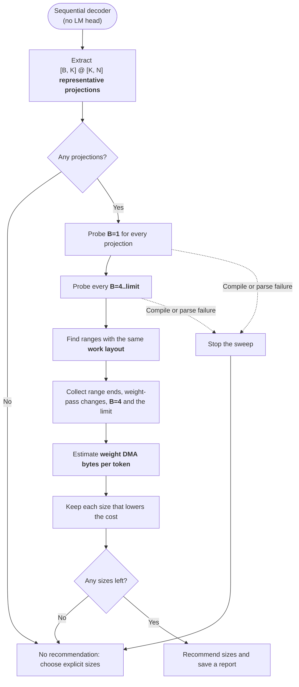
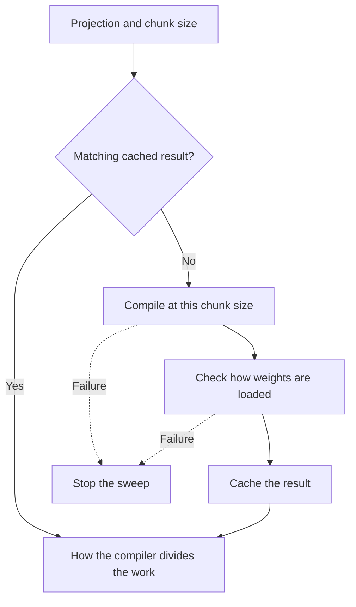
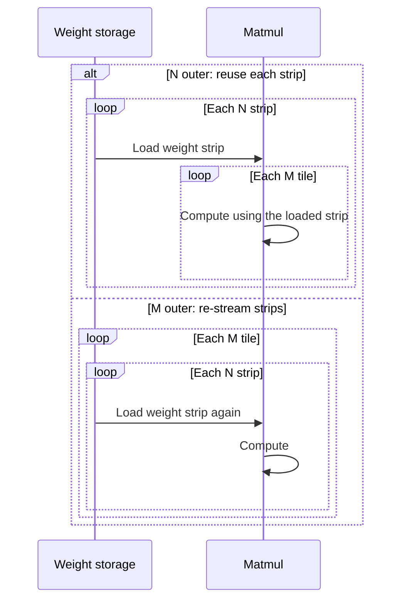
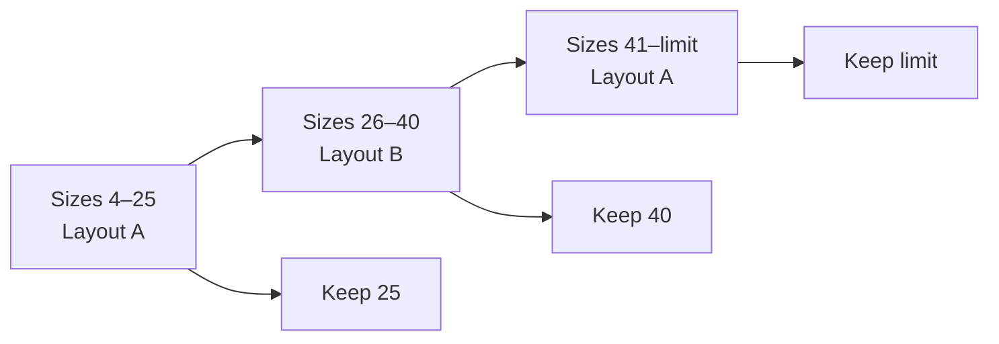

# Batch-prefill size probe

[`prefill_sizes.py`](prefill_sizes.py) recommends a family of chunk sizes that lower the estimated projection-weight DMA traffic per prompt token. It extracts representative projections from the sequential, unbatched transformer graph, then probes how the compiler's tile-and-fuse algorithm divides those projections into tiles at different chunk sizes. The LM head is currently excluded as it isn't extensively used during prefill. The [batch-prefill user guide](batch_prefill.md#optional-size-probe) covers the CLI and compiler workflow.

## DMA cost

The selector estimates bytes per token as the sum of each representative projection's packed constant bytes times its graph occurrence count times its weight-pass count, divided by the chunk length. Constant storage includes packed INT4 weights, scales, zero points and constant biases. Weight passes are `ceil(chunk length / token-tile step)` when the token loop surrounds the weight-strip loop, otherwise one. Structural deduplication retains occurrence counts; probe cache identity still uses the representative's real constants. This is a projection-weight traffic estimate: it does not model attention, activation/state transfers, transfer padding, compiler constant folding or DMA/computation overlap.

Candidates include the tiling-plateau boundaries, the last size before each weight-pass count changes, the minimum size four and the sweep limit. Keep increasing sizes that lower estimated DMA bytes per token; equal-cost candidates prefer the larger chunk while retaining four for tails. Sizes without a tile fit are excluded. Repeated weight loads are allowed when their total bytes per token improve, so large models still get several chunk sizes where a strict no-reload rule would leave only small ones. `prefill_sizes.json` records projection byte sizes and occurrence counts, and each candidate's total bytes, bytes per token and decision.

## Probe flow

Diagram legend: terms and symbols

| Term | Meaning here |
| --- | --- |
| Representative projection | One example of a matrix multiplication that transforms token features using learned weights. |
| Chunk size / B | Number of prompt tokens processed together. The sequential, unbatched transformer graph has B=1 for single-token prefill and generation. |
| B, K, N | In `[B, K] @ [K, N]`, B is the token count, K is the input feature count, and N is the output feature count. M in the technical notes means B. |
| Limit | Largest chunk size tested: the configured probe cap (default 128), or the model's context length if that is smaller and known. |
| Work | The projection's matrix multiplication for a chunk of tokens. This probe does not measure the whole prefill computation. |
| Work layout / tiling | How the compiler divides that multiplication into smaller pieces and orders their processing. |
| Weight strip / tile | A piece of the weight matrix loaded for computation. Strip width is the number of output features it covers. |
| Weight pass / re-streaming | One load of every weight strip. Re-streaming loads the strips again for each token group, adding weight passes. |
| Range / plateau | Consecutive chunk sizes with the same work layout. A signature records the layout details used to compare them. |
| Family | The final set of recommended chunk sizes. |

Selection rules and failure handling

A **weight strip** is a piece of the weight matrix loaded for computation. The strip's width is the number of output features it covers.

- A work layout describes the weight-strip width, whether tokens are split into smaller groups, and the order those groups and weight strips are processed.
- Consecutive chunk sizes with the same layout form a range (called a “plateau” in the report).
- Candidates are the largest size of each range with a recognized weight-strip width, the last size before any projection's weight-pass count changes, size 4 and the sweep limit.
- Walk the candidates in ascending order and keep each one whose estimated weight DMA bytes per token is no higher than the best so far; on a tie the larger size replaces the smaller, except size 4.
- Drop a candidate if any projection tiled along N at decode has no recognized weight tile at that size.
- No projections or no surviving candidates means no recommendation.
- Compile/parse failures also stop the sweep.
- Empty recommendations and failures require explicit sizes; this is not a fallback to a known optimal family.

The sections below explain these rules in detail.

## Representative projections

Extract representative constant-backed MatMul/Gemm projections, including their weights. For example, Gemma3's representative logical `[K, N]` shapes are `[640, 256]`, `[640, 1024]`, `[1024, 640]`, `[640, 2048]` and `[2048, 640]`. Deduplicate repeated graph/type structures across layers, retaining the representatives' real weights, types, scales, zero points and auxiliary operations like dequantization. Equal logical shapes with different types or quantization structures remain separate. Exclude the LM head from the source or through the caller, since it is compiled separately and is not used for batch prefill.

Compile each isolated projection at batch size B with the selected compiler flags, preserving its activation dtype and constant producers. Use the actual exported weight format: an FP32 source cannot predict an INT4 export. INT4 matmuls may receive BF16 operands while the compiler fuses dequantization and streams packed INT4 weights; a synthetic INT4 constant alone would not represent that chain.

Each probe first checks its cache:

What the probe records and how weight passes are counted

The cache matches the graph contents, chunk size, target, flags and compiler. On a cache miss, inspect the final `torq-tile-and-fuse` IR after compilation. Successful probe results remain cached even if a later probe fails.

Inspect the weight-strip width along N, whether M (the batch dimension) is tiled, and whether its loop is outside the N loop. M is B; K is reduced. An outer M loop causes weight strips to be streamed again for each M tile:

M tiling alone costs one weight pass. With an outer M loop, each M tile is another pass: `ceil(B / M step)` passes in total.

## Decode baseline and exhaustive sweep

Probe B=1 for every projection to establish its decode strip width, then probe every integer B from 4 through the cap, bounded by context length when known. The default cap is 128. Tiling is nonmonotonic: widths can shrink, jump up and shrink again, so binary search would miss transitions.

## Choose candidate sizes

Keep the largest chunk size in each consecutive range where the compiler divides the work the same way. It processes the most tokens with that layout. For example:

How ranges and candidates are defined

Group consecutive sizes with the same `(strip width, M tiled, M outer)` signature into plateaus. Candidate sizes are the union of the plateau endpoints with a recognized strip width of every projection tiled along N at decode, the last size before any projection's weight-pass count changes, 4 and the sweep limit. For example, an earlier Gemma3 `[640, 1024]` BF16 probe under stream scheduling used width 128 for B=4..25, making 25 a candidate.

In the diagram, each layout represents one signature. Returning to layout A starts a new range. Combine these endpoints across projections before costing; an endpoint valid for one projection can fail another.

## Reports, cache and limits

Report choices, plateaus and per-candidate costs and decisions in `prefill_sizes.json`. Cache individual probe results by extracted graph content (including weights), batch size, target, filtered flags, compiler path/mtime and probe version. Changing the representative's constants or graph invalidates its cached results.

LFM2.5 automatic sizing excludes the single-window channel-wise convolution rewrite, `[C,1,K] @ [C,K,1]` for C > 1. These MatMuls use independent kernels per channel rather than a shared projection across tokens. The exclusion applies to ONNX and imported MLIR sources; other unsupported batched weight shapes still fail the probe. Recommendations use the remaining shared projections and do not estimate convolution tiling or performance.

For LFM compiler builds affected by slow constant-prefetch scheduling, pass `--torq-constant-prefetch=false` to both the probe and final compilation. This disables an optional scheduling pass and must be recorded alongside performance measurements.

The heuristic does not score attention, softmax, other elementwise work outside the projection, surrounding fused-producer memory or runtime prompt scheduling. Validate the complete family on the target device. Raising context from 256 to 1024 does not expand the default sweep beyond 128 or add attention work to these probes.
