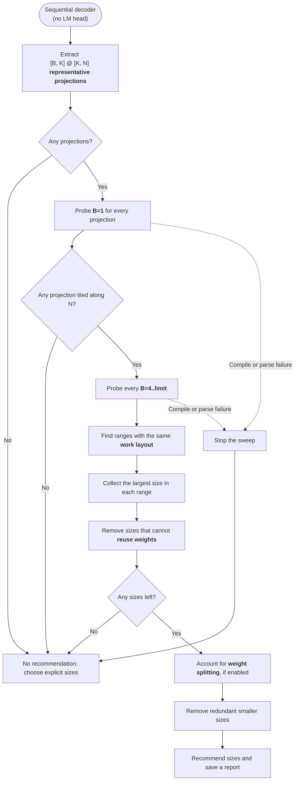
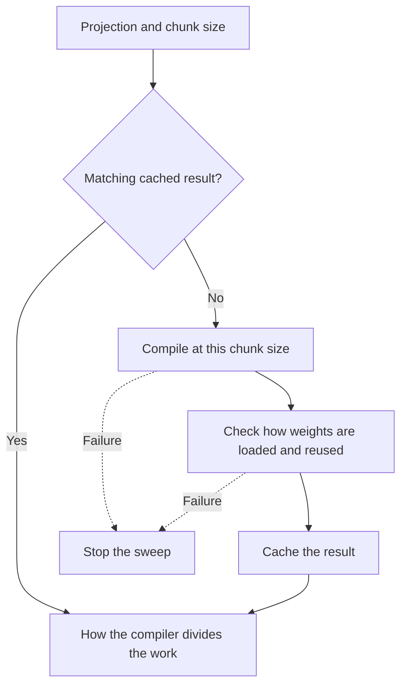
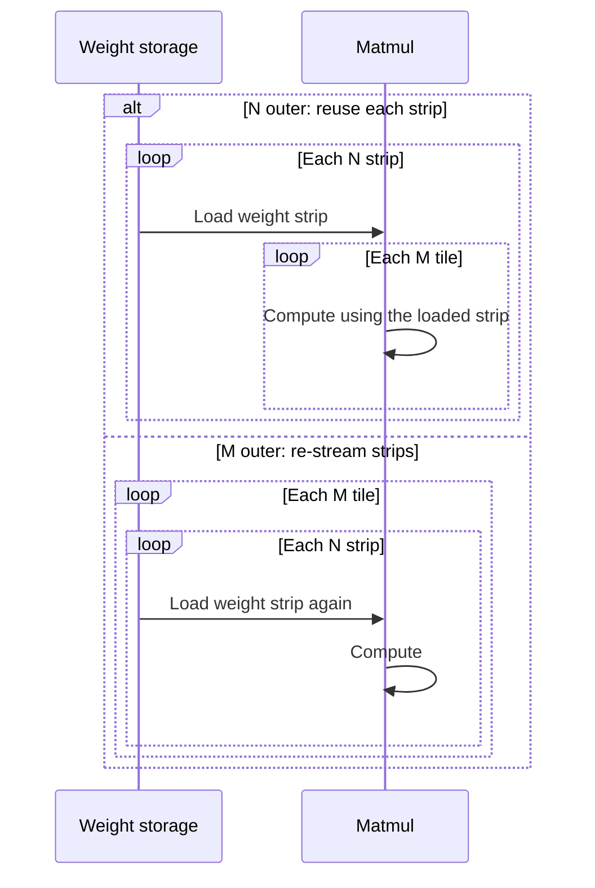
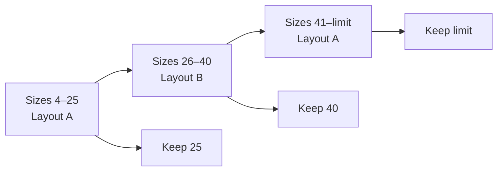

# Batch-prefill size probe

[`prefill_sizes.py`](prefill_sizes.py) recommends a family of chunk sizes that help reuse projection weights across tokens. It extracts representative projections from the sequential, unbatched transformer graph, then probes how the compiler's tile-and-fuse algorithm divides those projections into tiles at different chunk sizes. The LM head is currently excluded as it isn't extensively used during prefill. The [batch-prefill user guide](batch_prefill.md#optional-size-probe) covers the CLI and compiler workflow.

## Probe flow

Diagram legend: terms and symbols

| Term | Meaning here |
| --- | --- |
| Representative projection | One example of a matrix multiplication that transforms token features using learned weights. |
| Chunk size / B | Number of prompt tokens processed together. The sequential, unbatched transformer graph has B=1 for single-token prefill and generation. |
| B, K, N | In `[B, K] @ [K, N]`, B is the token count, K is the input feature count, and N is the output feature count. M in the technical notes means B. |
| Limit | Largest chunk size tested: the configured probe cap (default 128), or the model's context length if that is smaller and known. |
| Work | The projection's matrix multiplication for a chunk of tokens. This probe does not measure the whole prefill computation. |
| Work layout / tiling | How the compiler divides that multiplication into smaller pieces and orders their processing. |
| Weight strip / tile | A piece of the weight matrix loaded for computation. Strip width is the number of output features it covers. |
| Weight reuse / re-streaming | Reuse means computing for multiple tokens with an already loaded weight strip. Re-streaming means loading it again for each token group. |
| Range / plateau | Consecutive chunk sizes with the same work layout. A signature records the layout details used to compare them. |
| Weight splitting / split constants | A compiler option that splits stored weights into pieces. Its alignment rules can affect which layouts count as equivalent. |
| Family | The final set of recommended chunk sizes. |

## Representative projections

Extract representative constant-backed MatMul/Gemm projections, including their weights. For example, Gemma3's representative logical `[K, N]` shapes are `[640, 256]`, `[640, 1024]`, `[1024, 640]`, `[640, 2048]` and `[2048, 640]`. Deduplicate repeated graph/type structures across layers, retaining the representatives' real weights, types, scales, zero points and auxiliary operations like dequantization. Equal logical shapes with different types or quantization structures remain separate. Exclude the LM head from the source or through the caller, since it is compiled separately and is not used for batch prefill.

Compile each isolated projection at batch size B with the selected compiler flags, preserving its activation dtype and constant producers. Use the actual exported weight format: an FP32 source cannot predict an INT4 export. INT4 matmuls may receive BF16 operands while the compiler fuses dequantization and streams packed INT4 weights; a synthetic INT4 constant alone would not represent that chain.

Each probe first checks its cache:

What the probe records and why weight reuse matters

The cache matches the graph contents, chunk size, target, flags and compiler. On a cache miss, inspect the final `torq-tile-and-fuse` IR after compilation. Successful probe results remain cached even if a later probe fails.

Inspect the weight-strip width along N, whether M (the batch dimension) is tiled, and whether its loop is outside the N loop. M is B; K is reduced. An outer M loop causes weight strips to be streamed again for each M tile:

M tiling alone is allowed. Reject a candidate if any constrained projection has no recognized weight tile or has M tiling with an outer M loop.

## Decode baseline and exhaustive sweep

Probe B=1 for every projection to establish its decode strip width. For constrained projections, probe every integer B from 4 through the cap, bounded by context length when known. The default cap is 128. Tiling is nonmonotonic: widths can shrink, jump up and shrink again, so binary search would miss transitions.

## Choose candidate sizes

Keep the largest chunk size in each consecutive range where the compiler divides the work the same way. It processes the most tokens with that layout. For example:

How ranges and candidates are defined

Group consecutive sizes with the same `(strip width, M tiled, M outer)` signature into plateaus. Candidate sizes are the union of all constrained projections' plateau endpoints with a recognized strip width, plus 4 and the sweep limit. For example, an earlier Gemma3 `[640, 1024]` BF16 probe under stream scheduling used width 128 for B=4..25, making 25 a candidate.

In the diagram, each layout represents one signature. Returning to layout A starts a new range. Combine these endpoints across projections before filtering; an endpoint valid for one projection can fail another.

## Adjust and narrow the choices

Account for how the compiler splits weights, then remove smaller sizes that offer the same weight reuse as a larger choice. Keep size 4 if it passed the earlier checks.

Weight alignment and comparison rules

When split-constants optimization is enabled for direct BF16 weights, snap raw strip widths to the compiler's decode-based aligned strip grid. Other types and fused dequantization use their observed widths; the BF16 grid does not apply to their constant producers.

Compare the resulting `(effective width, M tiled, M outer)` signatures across all constrained projections. Drop a smaller candidate when a larger retained candidate has the same signatures: the smaller one processes fewer tokens per weight pass. B=4 is exempt from this pruning if it passed the rejection checks.

## Reports, cache and limits

Report choices, plateaus and candidate rejection reasons in `prefill_sizes.json`. Cache individual probe results by extracted graph content (including weights), batch size, target, filtered flags, compiler path/mtime and probe version. Changing the representative's constants or graph invalidates its cached results.

The heuristic does not score attention, softmax, other elementwise work outside the projection, surrounding fused-producer memory or runtime prompt scheduling. Validate the complete family on the target device. Raising context from 256 to 1024 does not expand the default sweep beyond 128 or add attention work to these probes.
